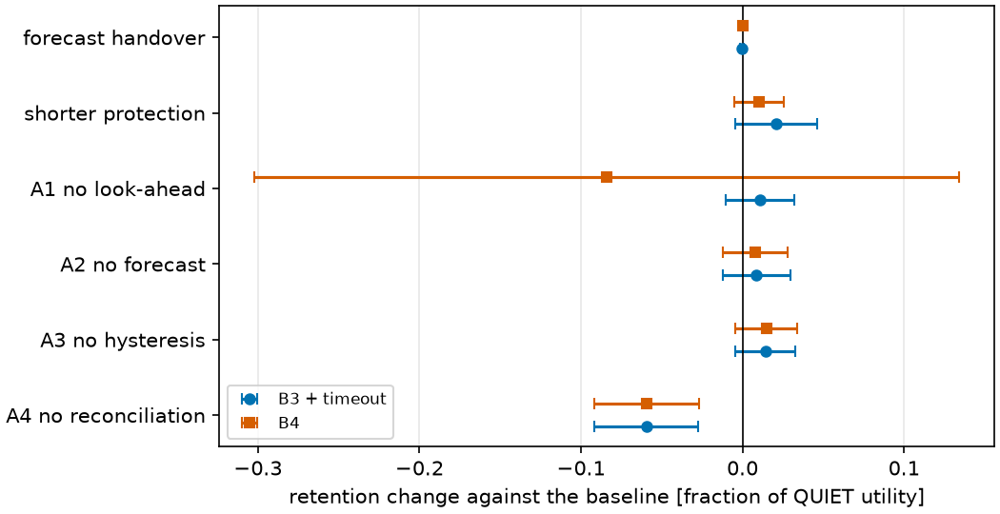
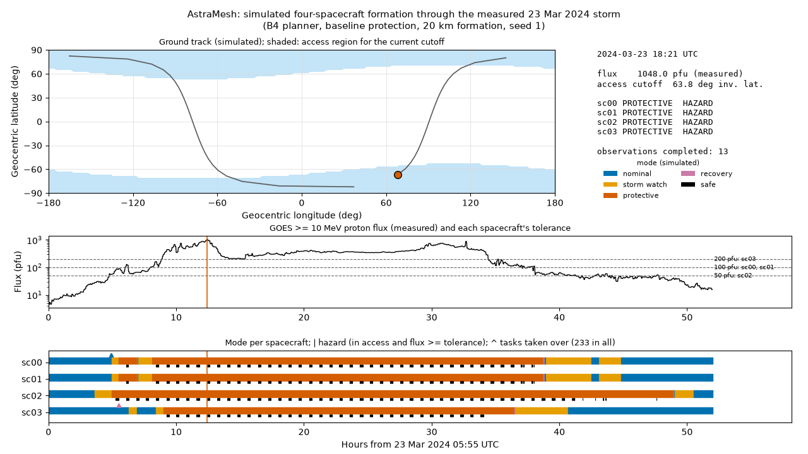

# AstraMesh

**Research platform for fault-tolerant decentralized spacecraft autonomy, intelligent mission planning, and space-weather resilience.**

AstraMesh is an independent, public-methods computational research project. It is a Python-first, CPU-feasible simulation platform for a **simulated four-spacecraft, decentralized low-Earth-orbit mission** that cooperatively schedules ionospheric observations, coordinates over constrained inter-satellite links, assesses its own health and environmental risk, and tries to preserve scientific value when spacecraft become unavailable or space-weather conditions worsen.

> **Project status: Phases 1–6 complete; Gate P6 signed off 2026-11-16 ([`docs/results/GATE_P6.md`](docs/results/GATE_P6.md)). v1.0.0 (Phases 1–5) is released ([`CHANGELOG.md`](CHANGELOG.md)).**
> **Read first: the technical report, [`docs/REPORT.md`](docs/REPORT.md).** It sets out the question, the simulated system, the data, the methods and every result with its interval, the negative results, related work and limitations.

The repository contains:

- **Dynamics.** Validated truth dynamics for a four-spacecraft formation: two-body, J2 and atmospheric drag, with physics acceptance tests and a Basilisk cross-check.
- **Mission model.** Mission geometry and resource accounting.
- **Agents.** Isolated spacecraft agents over a modelled crosslink network, with six allocation baselines.
- **Faults and protection.** Deterministic fault injection, per-agent health beliefs and a five-mode local protection supervisor.
- **Pinned real data.** OPS-SAT-AD telemetry, and OMNI and GOES-18 proton data for January 2023 – October 2026 (GOES only 8–15 May within May 2024).
- **Storm scenarios.** Proton-flux forecasts and per-spacecraft radiation risk, run over measured storms.

Every result about the formation is a **simulation** result with synthetic spacecraft and a modelled radiation hazard driven by **measured** storm data; the OPS-SAT anomaly benchmark and the forecast-skill scores are measured-data results outside the simulation. Nothing here should be read as a flight result or a validated finding, and no novelty is claimed. There is **no** science-retrieval model.

The authoritative design document is **[`ASTRAMESH_MASTER_SPEC.md`](ASTRAMESH_MASTER_SPEC.md)** (v1.0). Where this README and the specification differ, the specification governs.

---

## The problem

The core challenge is **decision-making under incomplete information**. A satellite that stops transmitting might be failed, healthy but disconnected, or deliberately in a protective mode. Each simulated spacecraft agent must act on its own estimates and the messages it actually receives — never on the simulator's global truth — while respecting finite power, storage, communication, propulsion, and safety constraints.

## Primary research question

> Can a decentralized spacecraft constellation preserve useful scientific operations during uncertain spacecraft-health events, communication disruption, and hazardous space-weather conditions while keeping local protection and maneuver constraints satisfied?

The specification defines five testable hypotheses (H1–H5) covering fault-aware task planning, explicit health uncertainty, space-weather-aware protection, a local safety supervisor, and forecast-informed protection. **These are hypotheses, not promised outcomes**; the final contribution may be narrowed to one of them after literature review and baseline experiments.

## Results

Inside the simulation (details, intervals and sources in [`docs/REPORT.md`](docs/REPORT.md)):

- **Reconciliation preserves science.** When one or two spacecraft are lost, CBBA with a health timeout and the rule-based redistribution keep all observable science, where a static schedule keeps 0.81 (one lost) or 0.68 (two lost). On six held-out storms, removing task reconciliation costs about 6 % of quiet-period utility, and both intervals exclude zero.
- **Protection buys hazard reduction cheaply.** The supervisor's forecast, look-ahead and hysteresis each prevent unprotected hazard on some storms, at a science cost whose interval includes zero.
- **The candidates did not beat the baseline.** The two methods proposed for coordinating protection across the formation (forecast handover and shorter protection) were frozen after tuning and did not improve on the baseline, either on their Phase 5 test storms or on six storms from June 2024 – January 2026 that no method had seen.
- **The remaining losses are explained.**
  - A close formation crosses each hazard region together, so a free peer is rare.
  - The remaining hazard sits at sharp onsets and falls with data latency.
  - One baseline (B4) can split task ownership. A re-sync fix recovered the lost tasks on the storms used to develop it and was neutral on two test storms, but adds duplicates where spacecraft that share tasks cannot hear each other.
- **The dynamics agree with Basilisk**, given the same models and constants, to 0.22 mm (J2) and 8 cm (J2 and drag) over 8 days. This checks the implementation, not the physics.



*F2: simulated retention change against the baseline on the six held-out storms, with 95 % intervals (n = 6).*



*A frame from the [demonstration video](docs/media/astramesh_demo_mar2024.mp4) (52 s, [about it](docs/media/README.md)): a simulated four-spacecraft formation through the measured 23 March 2024 solar proton event. All report figures are in [`docs/figures/`](docs/figures/README.md).*

## Research tracks

1. **Validated astrodynamics** — relative orbits, propagation (two-body first, then J2/drag), and resource-constrained maneuver modeling.
2. **Decentralized autonomy** — science-task allocation, network partitions, message delays, plan reconciliation, and graceful degradation.
3. **Intelligent state assessment** — probabilistic spacecraft-health inference, telemetry anomaly detection, and optional lightweight ML.
4. **Space-weather-aware protection** — a five-mode local supervisor (`NOMINAL`, `STORM_WATCH`, `PROTECTIVE`, `RECOVERY`, `SAFE`) that mission planning cannot override.
5. **Reproducible experiments** — strong classical baselines, external space-data sources, Monte Carlo evaluation, and honest reporting of failures and limitations.

Reinforcement learning is **optional**, not a requirement. ML is used for prediction and inference only, never as an unbounded controller.

## Reference mission (provisional values)

| Parameter | Starting value | Status |
|---|---|---|
| Spacecraft | 4 × 6U CubeSat-class abstractions | Approved |
| Orbit | ~525 km near-circular LEO, 97.5° inclination | Provisional — requires J2 validation |
| Formation | Along-track ("string-of-pearls"), ~20 km spacing | Provisional |
| Science | Simplified dual-frequency GNSS/TEC observation scheduling | Approved — a scheduling abstraction, not RO retrieval or tomography |

All physical and numerical parameters are starting points that must be validated; see §3 of the specification.

## Technology stack (as used)

| Area | Used |
|---|---|
| Language & environment | Python 3.12 on Ubuntu 24.04 (WSL2), Git |
| Dependency management | `uv`, `pyproject.toml`, `uv.lock` |
| Configuration | YAML validated with pydantic (unknown keys rejected) |
| Numerics & physics | NumPy, SciPy (including `milp` for B1), Astropy and ERFA for time, frames and units |
| Networking & discrete events | NetworkX, SimPy |
| Atmosphere | USSA 1976 (built in); NRLMSIS 2.0 through `pymsis` (`atmosphere` group, DL-084) |
| Data | h5py for the GOES netCDF-4 files (`data` group, DL-068) |
| Machine learning | scikit-learn; PyOD, xgboost-cpu and CPU-only PyTorch for the anomaly benchmark (`ml` group, DL-064) |
| Visualization | Matplotlib; ffmpeg through `imageio-ffmpeg` for the video only (`viz` group, not installed by default, DL-125) |
| Validation | Basilisk 2.12.2 in its own environment, [`tools/basilisk/`](tools/basilisk/) (DL-116) |
| Testing | pytest, Hypothesis, ruff, mypy (strict) |

Planned but not needed: Plotly, CVXPY + OSQP (no manoeuvre optimisation was built, DL-077), pandas, PyArrow and Xarray. Dependencies were added phase by phase, only when a tested requirement needed them (specification §11).

## External data

Used, each pinned by SHA-256 with its licence or terms checked ([`docs/DATASET_REGISTRY.md`](docs/DATASET_REGISTRY.md)):

- **ESA OPS-SAT-AD** telemetry (anomaly benchmark and health-model scores).
- **NASA OMNI / SPDF** 1-min and OMNI2 hourly data, for SYM-H, AE, F10.7 and ap.
- **NOAA NCEI GOES-18 SEISS / SGPS** ≥ 10 MeV proton flux, January 2023 – October 2026.

Planned but not used:
- **ESA-ADB:** sized only, too large for the available memory.
- **NOAA GloTEC:** starts in 2025.
- **UCAR COSMIC-2:** licence unverified.
- **CelesTrak GP / OMM.**

**No raw datasets are in this repository.** `scripts/data/fetch_data.py` downloads and hash-checks them. The derived storm series the simulation reads are committed under `configs/data/`.

## Getting started

Requires [uv](https://docs.astral.sh/uv/). uv installs the pinned Python version (3.12) automatically.

```bash
git clone https://github.com/Abdullah-Muz/AstraMesh.git
cd AstraMesh
uv sync --locked                     # create the environment from uv.lock

uv run pytest                        # tests
uv run ruff check . && uv run mypy   # lint and type checks

# Phase 0 toy scenario: proves same-seed replay (not a mission model)
uv run astramesh validate configs/experiments/toy_heartbeat.yaml
uv run astramesh run configs/experiments/toy_heartbeat.yaml --out results/toy

# Phase 1 dynamics baseline: 4 spacecraft, 20 km in-train, 24 h, point mass + J2
uv run astramesh run configs/experiments/formation_24h_j2.yaml --out results/formation
uv run astramesh plot results/formation          # diagnostic figures in results/formation/figures

# Phase 1 mission geometry: the same formation + illumination + science opportunities
uv run astramesh run configs/experiments/mission_geometry_24h.yaml --out results/mission
uv run astramesh plot results/mission

# Phase 2 increment 1: isolated agents exchanging status over the crosslink network
uv run astramesh run configs/experiments/agent_network_24h.yaml --out results/network

# Phase 2 S00: nominal science operations with B0 (static scheduler)
uv run astramesh run configs/experiments/nominal_ops_b0_24h.yaml --out results/ops_b0
uv run astramesh run configs/experiments/nominal_ops_b1_24h.yaml --out results/ops_b1   # B1 reference (privileged)
uv run astramesh run configs/experiments/nominal_ops_b2_24h.yaml --out results/ops_b2   # B2 auction
uv run astramesh run configs/experiments/nominal_ops_b3_24h.yaml --out results/ops_b3   # B3 CBBA

# Recorded experiments: each results page in docs/results/ names its script and run time
uv run python scripts/data/fetch_data.py                              # pinned external data
uv run python scripts/experiments/heldout_comparison.py --out <dir>   # e.g. the held-out storms

# Report figures and the demonstration video, from committed results only
uv run python scripts/figures/make_figures.py
uv run --group viz python scripts/figures/make_demo.py   # optional ffmpeg group (GPL build, external encoder)
```

A run writes `events.jsonl`, `summary.json`, `config.resolved.json`, and a provenance `manifest.json` (git commit, config hash, seeds, lockfile hash, artifact hashes). The formation scenarios also write `trajectory.csv` (sampled truth states), and the mission-geometry scenario writes `opportunities.json` (geometry-only science task records with energy and data costs) and a resource summary (battery, storage, Δv) in `summary.json`. See [`docs/EXPERIMENT_PROTOCOL.md`](docs/EXPERIMENT_PROTOCOL.md).

## Roadmap

| Phase | Focus | Status |
|---|---|---|
| 0 | Research and reproducibility foundation | Complete except the Priority A full-text literature review (in parallel; see [`docs/ROADMAP.md`](docs/ROADMAP.md)) |
| 1 | Validated four-spacecraft dynamics and mission geometry | Complete (Gate P1 signed off 2026-11-03) |
| 2 | Decentralized nominal science operations | Complete (Gate P2 signed off 2026-11-03) |
| 3 | Deterministic faults and protection supervisor | Complete (Gate P3 signed off 2026-11-04) |
| 4 | External data and probabilistic/ML experiments | Complete (Gate P4 signed off 2026-11-10) |
| 5 | Storm-aware distributed recovery | Complete (Gate P5 signed off 2026-11-13) |
| 6 | Research conclusion and public demonstration | Complete (Gate P6 signed off 2026-11-16) |

Each phase has explicit exit gates defined in specification §13.

## Scope and integrity

AstraMesh is a **simulation and research project**. It is **not** a real satellite constellation, flight software, a flight-validated system, or a NASA/ESA collaboration. It claims no novel algorithm: the one candidate contribution showed no improvement, and the related-work comparison is unverified. Results are reported as **simulated**, **model-based**, **measured** or **data-informed** as appropriate, and the negative results are reported as outcomes.

## Repository contents

| Path | Purpose |
|---|---|
| [`ASTRAMESH_MASTER_SPEC.md`](ASTRAMESH_MASTER_SPEC.md) | Authoritative research and engineering specification (v1.0) |
| [`docs/REPORT.md`](docs/REPORT.md) | Technical report (Phase 6) |
| [`docs/`](docs/) | Supporting documents: conventions, physics test plan, literature matrix, dataset registry, decision log, roadmap |
| [`docs/results/`](docs/results/) | Results pages with their per-run files and meta files (commit, config and data hashes); gate write-ups |
| [`docs/figures/`](docs/figures/README.md), [`docs/media/`](docs/media/README.md) | Report figures F1 – F9 and the demonstration video, drawn from committed results |
| [`src/astramesh/`](src/astramesh/) | Python package (`core/` clock, RNG, events, config; `dynamics/` validated truth dynamics, frames, time scales; `evaluation/` runner and manifests; `science/` region access and science opportunities; `resources/` energy, storage and Δv ledgers; `agents/` isolated spacecraft agents; `faults/` simulator-side fault injection (truth only); `datasets/` pinned external-data fetch, verification and the OPS-SAT-AD loader; `anomaly/` simulator-independent anomaly-detection benchmark on real telemetry; agent-side health beliefs and the protection supervisor in `agents/`; `planning/` external allocation (B0 static, B1 centralized reference); agent-side B2 auction and B3 CBBA in `agents/`; `communications/` messages and crosslink network; `scenarios/` runnable scenarios; `visualization/` diagnostic plots) |
| [`scripts/studies/`](scripts/studies/) | Reference-error studies behind every physics test tolerance |
| [`scripts/experiments/`](scripts/experiments/), [`scripts/data/`](scripts/data/), [`scripts/figures/`](scripts/figures/) | Recorded experiments, pinned-data fetch and series builders, figure and video rendering |
| [`tools/basilisk/`](tools/basilisk/) | Separate environment for the Basilisk cross-check |
| [`configs/`](configs/) | Scenario configuration files (YAML) |
| [`tests/`](tests/) | Unit, integration, and regression tests |
| `data/` | Local, Git-ignored dataset area (no data committed) |
| [`CHANGELOG.md`](CHANGELOG.md) | Release notes (v1.0.0: Phases 1–5) |
| `pyproject.toml`, `uv.lock`, `.python-version` | Project metadata and locked dependencies |
| `.github/workflows/ci.yml` | Continuous integration: lint, type check, tests, baseline smoke runs |
| [`LICENSE`](LICENSE) | MIT License — applies to source code |
| [`LICENSE-DOCS`](LICENSE-DOCS) | Creative Commons Attribution 4.0 International — applies to documentation |

## License

AstraMesh uses two licenses:

- **Code — [MIT License](LICENSE).** Applies to all source code, tests, scripts, configuration files, and other software in this repository unless a file states otherwise.
- **Documentation — [CC BY 4.0](LICENSE-DOCS).** Applies to [`ASTRAMESH_MASTER_SPEC.md`](ASTRAMESH_MASTER_SPEC.md), this README, the contents of `docs/`, and written reports, diagrams, and figures, unless a file states otherwise.
- **Third-party, optional: NRLMSIS 2.0.** The `atmosphere` dependency group installs [`pymsis`](https://github.com/SWxTREC/pymsis) (MIT), which provides the NRL MSIS model. MSIS itself is licensed by the U.S. Naval Research Laboratory for **academic, non-commercial use only** (see its `MSIS2_LICENSE`); AstraMesh neither modifies nor redistributes it. It is needed only for storm-time density (`dynamics.drag.density: msis2`, DL-084); the default drag model and every other feature work without it.

Copyright © 2026 Abdullah Muzher.

**Attributing the documentation:** when reusing or adapting documentation, credit it as, for example:

> *AstraMesh Master Research & Engineering Specification* by Abdullah Muzher, https://github.com/Abdullah-Muz/AstraMesh, licensed under [CC BY 4.0](https://creativecommons.org/licenses/by/4.0/). Indicate if changes were made.

**Not covered:** external datasets, third-party publications, and other third-party material referenced by this project remain under their owners' terms and are not relicensed here.
