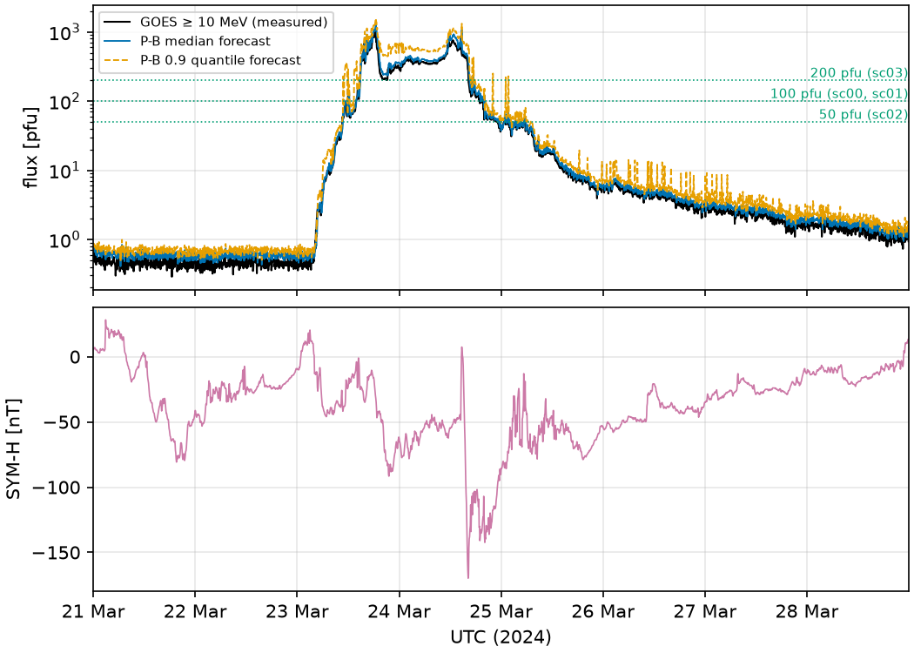
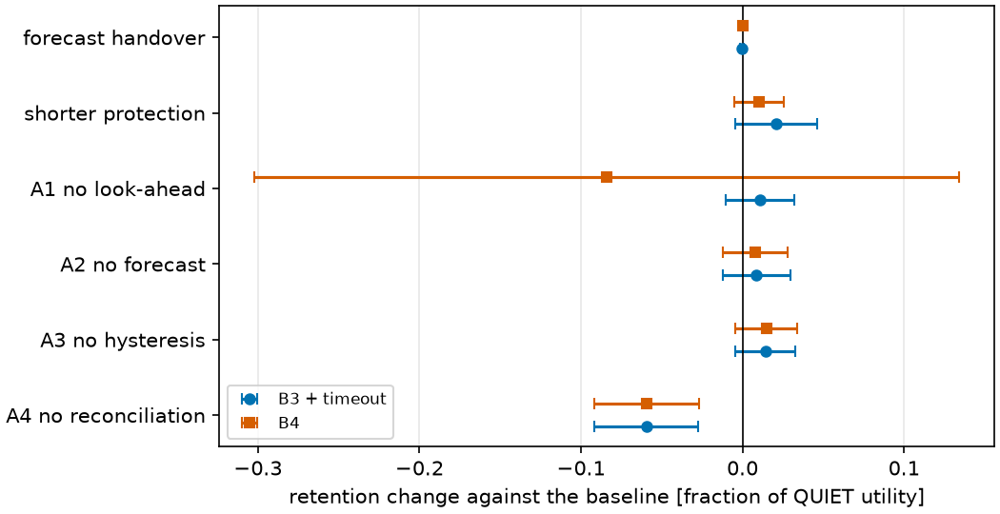
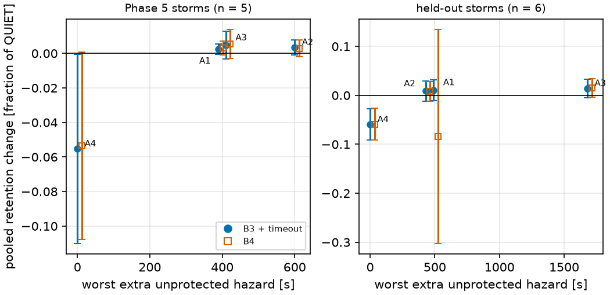
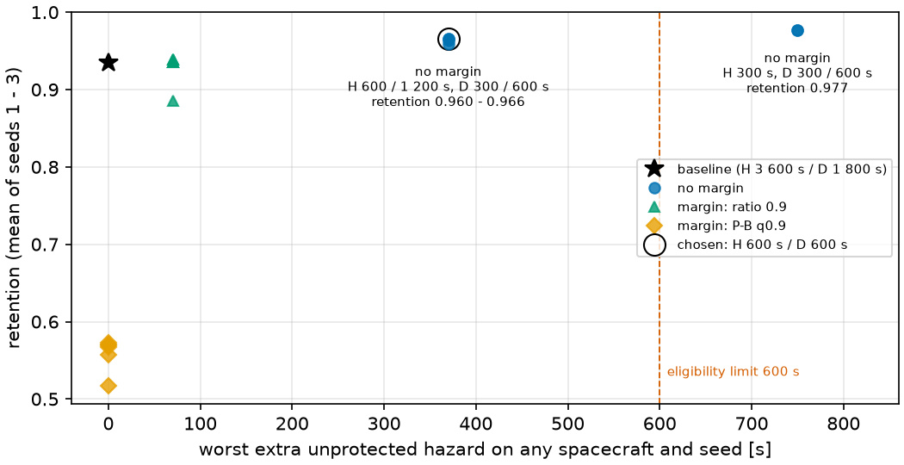
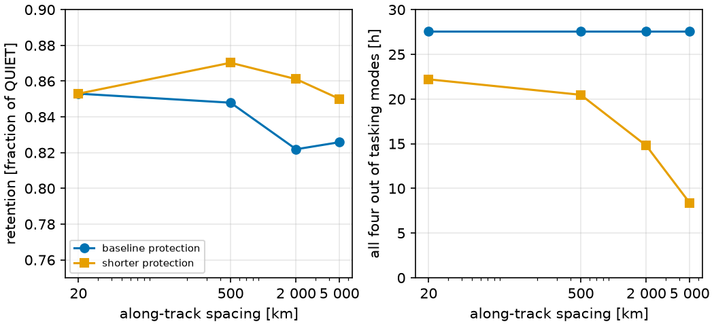
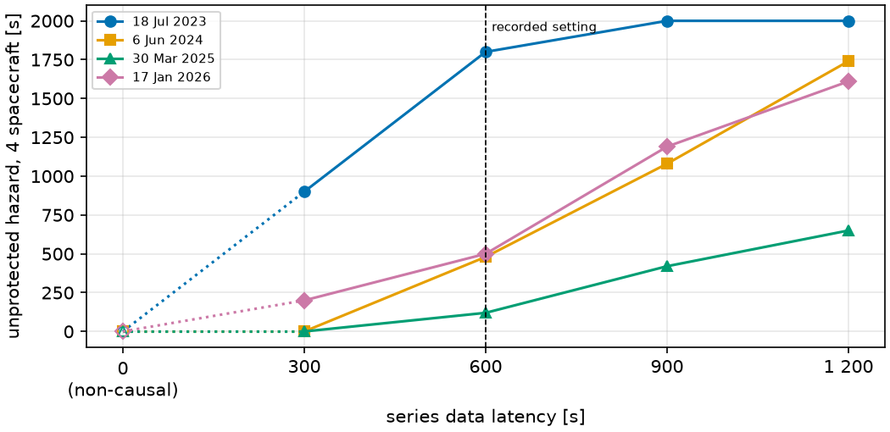
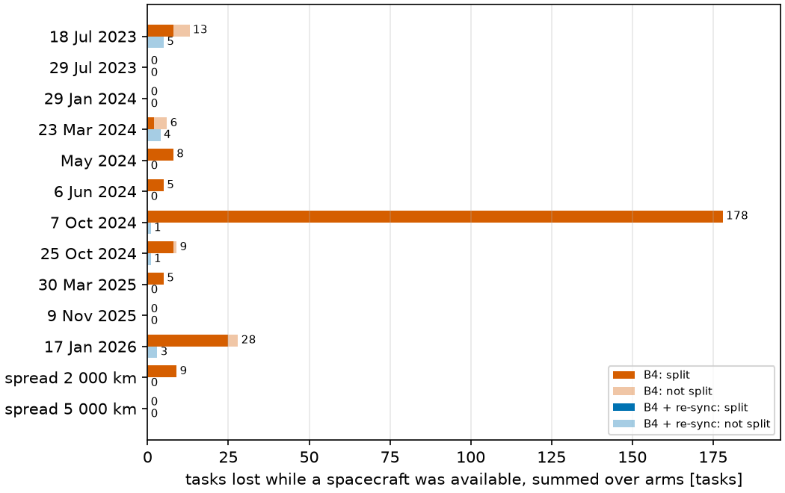
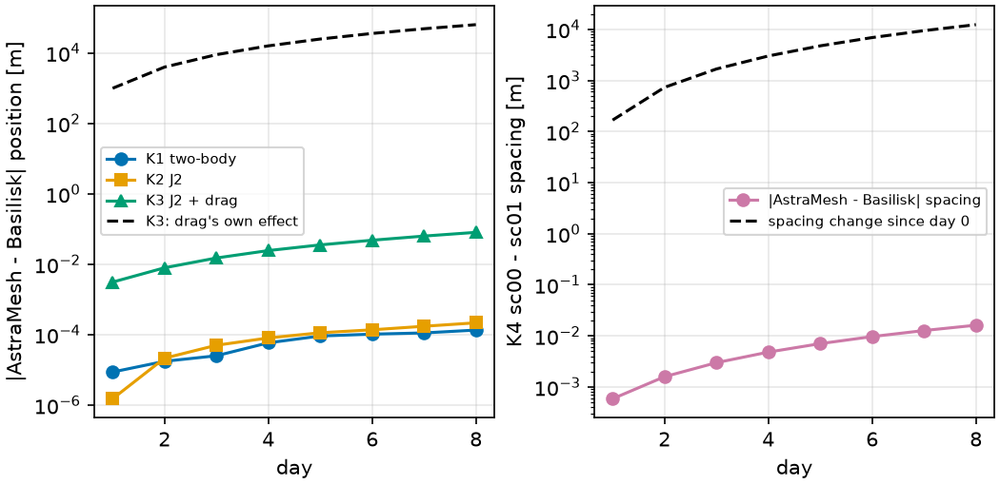
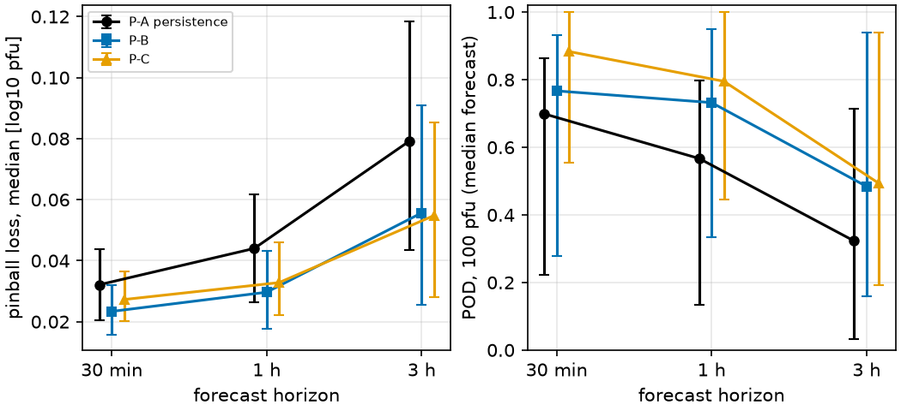

# Report figures

Drawn by `scripts/figures/make_figures.py` from committed files only (`docs/results/` and the pinned `configs/data/` series); the script computes no new result. The PNGs are not byte-reproducible, so they are not hashed. Regenerate with:

    uv run python scripts/figures/make_figures.py

Simulated: the formation, utility, hazard and protection. Measured: GOES proton flux and OMNI SYM-H. No figure shows a real mission.

Data credits (GOES-18 SGPS: NOAA NCEI and GOES-R SEISS; OMNI: NASA/GSFC SPDF OMNIWeb, with the data citation) are in the project [README](../../README.md#external-data).

## F1. The March 2024 storm window (21 - 28 March)

Measured GOES ≥ 10 MeV proton flux (5-min records) and the P-B forecasts of the next-hour maximum, plotted at their issue time (record start + 600 s latency), with the three modelled spacecraft tolerances; below, measured OMNI SYM-H. The forecasts are model outputs from the pinned series; the tolerances are synthetic limits, not properties of a real payload. The whole 8-day pinned window is shown (21 - 28 Mar 2024); the onset is on 23 Mar.

Sources: `configs/data/fold_mar23_2024_series.json`

## F2. Held-out storms: retention change by arm

Simulated: pooled retention change against the baseline protection over the six held-out storms (mean and 95 % t-interval, n = 6), for both planners, driven by measured storm data (HELDOUT.md, DL-115). The wide B4 interval under A1 measures B4's ownership-split defect, not the value of look-ahead.

Sources: `docs/results/heldout_summary.csv`

## F3. Ablations: science against hazard

Simulated: pooled retention change (mean and 95 % t-interval) against the worst extra unprotected hazard on any spacecraft and storm, for each ablation; left the five Phase 5 storms (ABLATIONS.md, DL-108), right the six held-out storms (HELDOUT.md, DL-115). Filled: B3 + timeout; open: B4 (same hazard, protection is planner-independent; B4 is drawn slightly to the right for legibility). By spec §10.2 a gain that adds unprotected hazard is not better.

Sources: `docs/results/ablation_summary.csv`, `docs/results/heldout_summary.csv`

## F4. Protection tuning on the February 2024 storm

Simulated: retention (mean of seeds 1 - 3) against the worst extra unprotected hazard for each look-ahead H / release dwell D (seconds) and margin, planner B4, on the tuning storm (PROTECTION_TUNING.md). Arms right of the 600 s limit were not eligible (DL-101). Several arms coincide: the margin variants share one hazard value each.

Sources: `docs/results/protection_tuning_summary.csv`

## F5. Spread formation on 23 - 24 March 2024

Simulated: retention against QUIET at the same spacing, and hours with all four spacecraft out of the tasking modes at once, against along-track spacing (B4, seeds 1 - 3 identical; SPREAD_FORMATION.md). Duplicates are not charged here: at 2 000 km shorter protection makes 108 duplicates and, charged, falls below the baseline.

Sources: `docs/results/spread_summary.csv`

## F6. Data latency and onset hazard

Simulated: baseline unprotected hazard (summed over the four spacecraft; all of it at onsets) against the latency of the measured-data series, on the four storms whose baseline has unprotected hazard (NEGATIVE_RESULTS.md N6). 0 s is non-causal (the 5-min average is not yet complete) and is a bound only.

Sources: `docs/results/negative_results.json`

## F7. B4 ownership re-sync: tasks lost while available

Simulated: tasks completed in the storm's B4 QUIET but lost while some spacecraft was in a tasking mode for a whole window, summed over the storm's arms, B4 against B4 + re-sync, on the development storms (five Phase 5 and six held-out storms) and the two spread runs (2 000 and 5 000 km) (seed 1; RESYNC_COMPARISON.md, DL-124). Dark: split tasks. These storms were used to develop the re-sync; on the two test storms nothing changed. Not shown: in the 2 000 km spread run the re-sync raised duplicates from 15 to 111.

Sources: `docs/results/resync_pairs.csv`

## F8. AstraMesh against Basilisk

Simulated: daily differences between AstraMesh and Basilisk propagations of the same cases over 8 days (BASILISK_COMPARISON.md, DL-118). Left: position difference for K1 - K3, with drag's own effect under K3 for scale. Right: the K4 spacing difference against the spacing change it is compared with.

Sources: `docs/results/basilisk_daily.csv`

## F9. Proton forecast skill against horizon

Forecasts (P-B, P-C) and persistence (P-A) scored against measured GOES flux on the held-out storm week, 8 - 15 May 2024: pinball loss of the median (lower is better) and row-wise POD at 100 pfu, with 95 % day-bootstrap intervals (STORM_FORECAST.md, DL-073). One storm week; intervals are coarse.

Sources: `docs/results/storm_forecast.csv`
