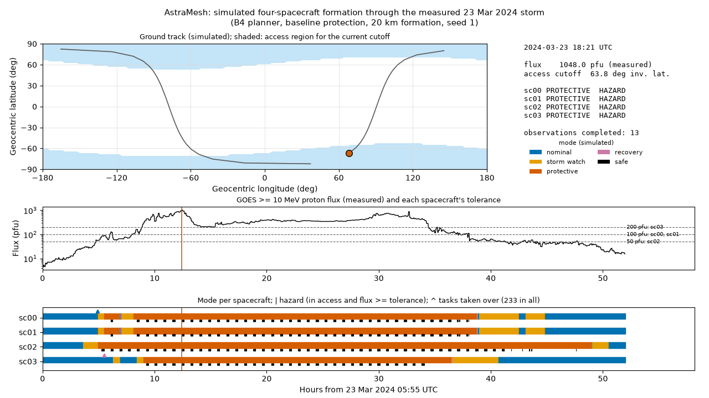

# Demonstration video

[`astramesh_demo_mar2024.mp4`](astramesh_demo_mar2024.mp4) (52 s, 1280 × 720, H.264) and a still of the frame with the highest flux, [`astramesh_demo_mar2024.png`](astramesh_demo_mar2024.png).

**What it shows:** a *simulated* four-spacecraft formation (B4 planner, baseline protection, 20 km along-track spacing, seed 1) through the *measured* 23 Mar 2024 solar proton event (GOES ≥ 10 MeV flux and OMNI SYM-H, the DL-098 series). It covers 52 h, from 6 h before the first record ≥ 100 pfu, with one frame per 2 min of simulated time.

- **Map:** the formation's ground track (geocentric coordinates, no coastlines). The shading shows the access region for the current cutoff, where invariant latitude is at least the SYM-H-dependent cutoff. The four spacecraft are within 60 km of each other, so one marker, coloured by sc00's mode, stands for the formation.
- **Flux:** the measured flux against each spacecraft's tolerance (50 / 100 / 200 pfu), with a time cursor.
- **Modes:** one strip per spacecraft (nominal, storm watch, protective, recovery). The ticks below each strip mark hazard steps, where the spacecraft is in access and the flux is at or above its tolerance. The triangles mark tasks the spacecraft took over from peers (233 in this window, all when the formation entered protection).

It is not a real mission or flight data. The planner and protection settings are those evaluated in Phase 5 (DL-100); this run's utility is 969 points, as recorded in DL-124.

**Provenance:** rendered by `scripts/figures/make_demo.py` from [`docs/results/demo_trace.json`](../results/demo_trace.json) only. The trace was written by `scripts/experiments/demo_trace.py` from clean commit `74273a0`. That script checks that the config hash (`30142d2b…`) and the utility equal the recorded run, and that its rebuilt hazard equals the run's (DL-125 – DL-127).

**Regenerate:**

    uv run python scripts/experiments/demo_trace.py --out <dir>        # about 2 min
    uv run --group viz python scripts/figures/make_demo.py               # about 12 min

The `viz` group installs `imageio-ffmpeg`, whose bundled ffmpeg is a GPL v3+ build, used only as an external encoder. MP4 and PNG bytes depend on the encoder build, so they are not hashed.
